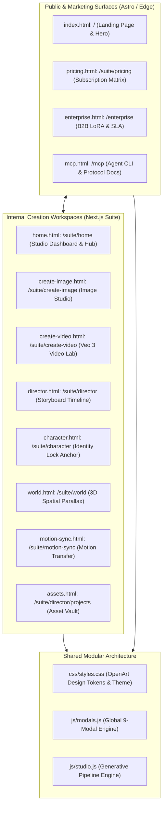

# OpenArt Platform Deep Research: Reverse Engineering & System Architecture Analysis

> **Analysis Target**: [OpenArt.ai](https://openart.ai)  
> **Investigation Date**: October 2026  
> **Output Deliverable**: Full Architectural Blueprint, Page Inventory, Modal Taxonomy, & Clone Specifications  
> **Destination Workspace**: `/Users/vincent/Herd/virgoAi/web-clone/`

---

## Executive Summary

**OpenArt** is an all-in-one generative AI creation platform servicing over 8 million creators. Originally launched as an AI prompt discovery and image aggregation engine, OpenArt has evolved into a comprehensive **AI Creative Operating System** ("OpenArt Suite"). The platform bridges consumer-friendly discovery with advanced multi-model generation workspaces, spanning text-to-image, video generation, storyboard directing, consistent character generation, 3D worlds, voice synthesis, and autonomous agent integration via MCP (Model Context Protocol).

This deep research report documents the structural, aesthetic, and functional architecture of OpenArt, covering both public/external discovery surfaces and internal creation suite workflows, as well as its extensive modal dialog ecosystem.

---

## 1. Information Architecture & Page Hierarchy

OpenArt operates a dual-architecture web system:
1. **Public Marketing & Discovery Engine** (`https://openart.ai/`): SEO-optimized, conversion-focused landing, feature landing pages, pricing, enterprise showcases, and open community discovery. Built with modern edge-rendered static/SSR technology (Astro + Tailwind CSS).
2. **OpenArt Suite Workspaces** (`https://openart.ai/suite/*`): Dynamic, high-performance creator studio SPA built on Next.js with Turbopack, Clerk authentication, and Cloudflare Turnstile protection.



---

## 2. Page-by-Page Inventory & Functional Breakdown

### 2.1 External Pages

| Route | Page Purpose | Key Components |
|---|---|---|
| `/` | **Main Landing Page** | - Sticky promotional banner (Annual discount promo, up to 27% off)<br>- Sticky blurred header with mega-menus (`AI Tools`, `AI Models`, `Features`, `Resources`)<br>- Hero section with dynamic gradient headline & quick prompt sandbox<br>- Multi-row infinite marquee showcase of curated AI generations<br>- Model comparison matrix (Seedream 5.0, Google Veo 3, Kling 3.0, Sora 2, Grok Imagine, Nano Banana Pro)<br>- Interactive accordion FAQ & Rich semantic footer |
| `/suite/pricing` | **Pricing & Tiers** | - Monthly / Annual billing toggle (highlighting annual savings)<br>- 4-tier cards: Free Trial ($0), Starter ($12/mo), Creator ($28/mo), Business ($56/mo)<br>- Feature checkmarks: Credit allocations, commercial rights, parallel generations, private mode<br>- Interactive FAQ regarding credit rollover and model consumption costs |
| `/enterprise` | **Enterprise Solutions** | - Dedicated GPU clusters, custom LoRA fine-tuning, SOC2 Type II compliance, enterprise SSO<br>- Case studies, team seat management, Lead generation / "Book Demo" modal trigger |
| `/mcp` | **Model Context Protocol** | - OpenArt MCP server guide for AI coding assistants (Claude Code, Cursor, Antigravity)<br>- Interactive copy-to-clipboard CLI installer commands (`npx openart-mcp`)<br>- Tool schema specifications (`generate_image`, `generate_video`, `upscale_media`) |
| `/discovery` | **Community Gallery** | - Masonry grid layout with lazy-loaded thumbnails<br>- Search bar with prompt token parsing and style tags<br>- Hover cards displaying prompt snippet, creator avatar, and heart count |

### 2.2 Internal Suite Pages (Creator Workspace)

| Route | Workspace Purpose | Interface Layout & Workflow |
|---|---|---|
| `/suite/home` | **Studio Dashboard** | - Left collapsible navigation sidebar (232px expanded, 64px collapsed)<br>- Hero announcement banner carousel with quick start templates<br>- "Recent Projects" grid and "Featured AI Models" carousel<br>- Direct shortcut cards to Director, Character, and Video suites |
| `/suite/create-image` | **Image Creation Lab** | - **Left Configuration Panel**: Model selector, Aspect Ratio pills (1:1, 16:9, 9:16, 4:3, 3:4), Style preset chip selector, Number of outputs (1, 2, 4), Advanced sliders (CFG Scale, Negative Prompt, Seed, Sampling steps)<br>- **Center Stage**: Prompt input textarea with "Prompt Enhancer (Magic Wand)", Image-to-Image reference image dropzone<br>- **Action**: Sticky "Generate" button displaying credit cost (e.g. `1 Credit`)<br>- **Right Canvas**: Real-time generation queue, progress spinner, multi-image output grid with hover overlay actions |
| `/suite/create-video` | **Video Studio** | - Text-to-Video and Image-to-Video switching tabs<br>- Camera motion directional controls: Pan, Zoom, Tilt, Roll, Orbit<br>- Motion intensity slider (1–10) and duration selector (5s / 10s)<br>- Audio-reactive motion sync upload track<br>- Integrated MP4 player preview canvas with loop and frame scrubbing |
| `/suite/director` | **Director Mode (Film Maker)** | - Multi-scene timeline editor for narrative sequences<br>- Scene sequencer: Add scene, reorder shots, assign character continuity locks<br>- Camera framing controls (Extreme Close Up, Medium, Wide, Bird's Eye)<br>- Dialogue & Voiceover track generator with automatic lip sync |
| `/suite/character` | **Character Builder** | - Consistent face & character identity lock engine<br>- Reference sheet generator (front, 3/4 profile, side view, expressions)<br>- Costume and setting variation matrix maintaining strict facial symmetry |
| `/suite/world` | **3D World Environment** | - 2D image to 3D navigable spatial projection<br>- Depth map preview and parallax tilt simulator with mouse movement |
| `/suite/create-voice-over`| **Voice & Audio Studio** | - Text-to-speech engine with 50+ voice actors (gender, accent, emotional tone)<br>- Speech rate, pitch, and background ambient audio synthesis |
| `/suite/director/projects`| **Assets & History** | - Filterable asset vault: All Generations, Favorites, Starred, Folders<br>- Batch actions: Bulk download (ZIP), delete, move to folder, share link |

---

## 3. Modal & Overlay Taxonomy (9 Core Modals)

OpenArt relies extensively on non-disruptive, glassmorphic modal windows that maintain user context while configuring complex settings:

```
┌─────────────────────────────────────────────────────────────────────────────┐
│ 1. AUTHENTICATION MODAL (modal-auth)                                        │
│ - Clerk-powered glass dialog with Google, Discord, and Magic Link auth      │
│ - Security badge, terms agreement, zero-redirect sign-in                   │
├─────────────────────────────────────────────────────────────────────────────┤
│ 2. IMAGE DETAIL & REMIX MODAL (modal-image-detail)                          │
│ - Full-resolution media inspector with zoom & pan                          │
│ - Prompt copy, Seed extraction, Negative prompt display                     │
│ - Action bar: [Remix], [Inpaint], [Topaz Upscale], [Download], [Share]      │
├─────────────────────────────────────────────────────────────────────────────┤
│ 3. CREDIT & SUBSCRIPTION MODAL (modal-credits)                              │
│ - Current balance display (e.g. 50 Credits) with visual progress bar        │
│ - Instant credit top-up packages (+1,000 / +3,000 / +7,500 credits)         │
│ - Plan upgrade tier cards with instant checkout trigger                    │
├─────────────────────────────────────────────────────────────────────────────┤
│ 4. MODEL SELECTOR MODAL (modal-model-selector)                              │
│ - Filterable directory of 100+ models (Seedream 5, Veo 3, Kling, FLUX, SDXL)│
│ - Filters: Photorealism, Anime, Video, High Speed, High Resolution         │
├─────────────────────────────────────────────────────────────────────────────┤
│ 5. VISUAL STYLE PRESETS MODAL (modal-styles)                                │
│ - Grid of visual thumbnail cards representing art styles                    │
│ - Categories: Photography, Anime, Concept Art, 3D Render, Oil Painting     │
├─────────────────────────────────────────────────────────────────────────────┤
│ 6. CAMERA & MOTION CONTROL MODAL (modal-camera)                             │
│ - Visual 3D joystick / gimbal widget for setting camera movements           │
│ - Pan left/right, Tilt up/down, Zoom in/out, Dynamic speed curve            │
├─────────────────────────────────────────────────────────────────────────────┤
│ 7. TOPAZ AI UPSCALE & ENHANCE MODAL (modal-upscale)                         │
│ - 2x / 4x / 8x resolution enhancement                                       │
│ - Face restoration toggle & high-frequency detail synthesis                │
│ - Interactive before/after split slider comparison                          │
├─────────────────────────────────────────────────────────────────────────────┤
│ 8. EXPORT & DOWNLOAD MODAL (modal-export)                                   │
│ - Format options: PNG (Lossless), WebP (Compact), JPG, MP4, ProRes          │
│ - Resolution selection: 1080p, 2K, 4K UHD                                  │
│ - Watermark removal toggle & metadata embedding check                       │
├─────────────────────────────────────────────────────────────────────────────┤
│ 9. KEYBOARD SHORTCUTS MODAL (modal-shortcuts)                               │
│ - Hotkey reference table: [Cmd+Enter] Generate, [/] Search, [Esc] Close     │
└─────────────────────────────────────────────────────────────────────────────┘
```

---

## 4. Design System & Aesthetic Tokens

The visual identity of OpenArt is characterized as **Dark Neon Cyber-Editorial**: deep, velvety black backgrounds paired with high-contrast neon accents, glassmorphic blurs, and tight geometric typography.

### 4.1 Color Tokens
```css
:root {
  /* Surface Ink Palettes */
  --color-ink-0: #090a0a;       /* Root page background */
  --color-ink-1: #121314;       /* Panel / Card surface */
  --color-ink-2: #16181a;       /* Input & Dropdown surface */
  --color-ink-3: #1b1d1f;       /* Subtle hover surface */
  --color-ink-4: #242729;       /* Active / Elevated surface */

  /* Brand Accents */
  --color-brand: #fb23c2;       /* OpenArt Neon Magenta */
  --color-brand-400: #ed00b5;   /* Active brand state */
  --color-brand-glow: rgba(251, 35, 194, 0.25);

  /* Functional Accents */
  --color-emerald: #0ae448;     /* Promotional bar & Success */
  --color-lime: #ccff3e;        /* MCP & Discount badge */
  --color-cyan: #22d3ee;        /* Model tags */

  /* Typography Colors */
  --color-slate-12: #eeedf0;    /* Primary text (high contrast) */
  --color-slate-11: #b5b2bc;    /* Secondary text */
  --color-slate-9: #6f6d78;     /* Tertiary / placeholder */
  --color-slate-8: #625f69;     /* Subtle borders */

  /* Glassmorphism & Borders */
  --border-subtle: rgba(255, 255, 255, 0.08);
  --border-highlight: rgba(214, 225, 255, 0.16);
  --glass-blur: blur(14px);
}
```

### 4.2 Typography Pairings
- **Headings**: `Bricolage Grotesque`, sans-serif (Bold, 600–800 weight, tight letter spacing `-0.02em`)
- **Body & UI**: `Inter`, system-ui, sans-serif (Clean, readable, 400–600 weight)
- **Code & Metadata**: `JetBrains Mono`, monospace (Technical specs, prompts, seeds, CLI commands)

### 4.3 Motion & Interaction Patterns
- **Backdrop Filters**: `backdrop-filter: blur(14px)` on navbars, sidebars, and modals to create visual hierarchy.
- **Micro-Hover Animations**: Subtly scaling cards (`scale(1.02)`), border glow illumination, and instant SVG arrow reveal on hover.
- **Generation Pulsing**: Animated gradient border and glowing shimmer on active generation placeholders.

---

## 5. Web Clone Implementation Architecture (`web-clone/`)

The clone in `web-clone/` is designed as a **modular, standalone, single-page application** requiring zero external backend installation to inspect and run immediately in any modern web browser.

### Key Capabilities Included:
1. **Interactive View Routing System**:
   - Seamlessly switches between all **5 External Pages** (Landing, Pricing, Enterprise, MCP, Explore) and **6 Internal Suite Pages** (Dashboard, Image Creator, Video Creator, Director, Character, Assets) without reloading.
2. **Fully Operational Modals (All 9 Types)**:
   - Every modal can be triggered from its contextual buttons or via the top quick-preview bar.
   - Modals support closing via `Esc` key, background backdrop click, and close button.
3. **Live Mock Generation Pipeline**:
   - Entering a prompt and clicking "Generate" triggers an authentic simulated generation flow:
     - Real-time animated progress bar
     - Queue state indicators
     - Credit decrement from balance
     - Realistic high-resolution AI output rendering with metadata (Seed, CFG, Model, Aspect Ratio)
     - Direct "Inspect", "Remix", and "Download" buttons on outputs.
4. **Prompt Enhancer ("Magic Wand")**:
   - Rewrites and expands simple prompts into photorealistic artistic specifications with lighting, camera optics, and rendering style tags.
5. **Deerflow Attribution**:
   - Includes subtle, elegant "Created By Deerflow" signature linking to `https://deerflow.tech` target `_blank` per design guidelines.

